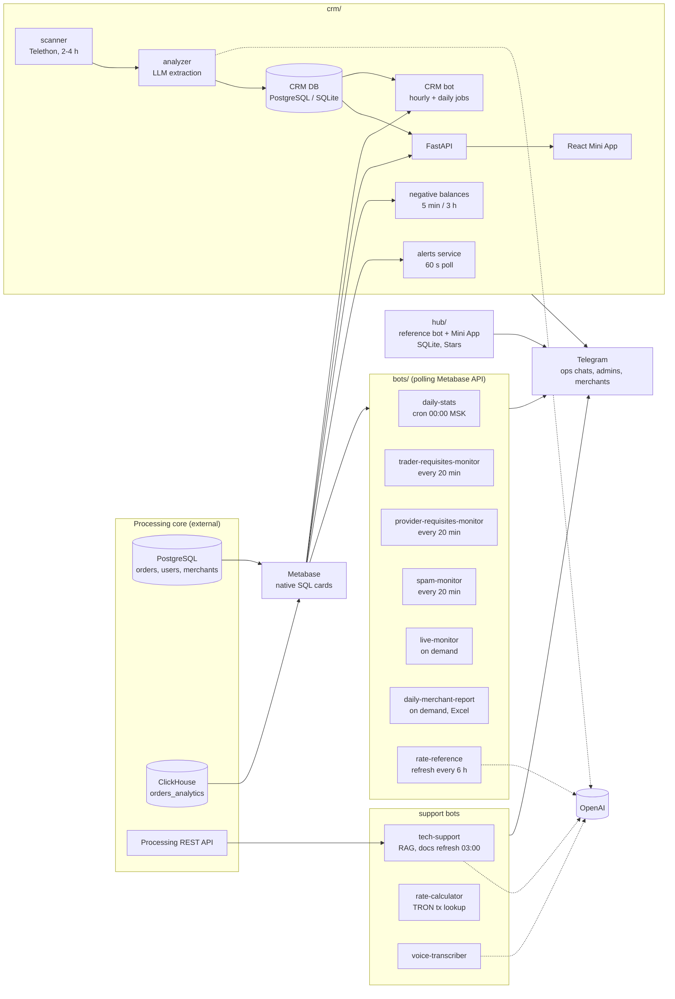

# Processing Hub

Processing Hub - operations platform for a payment processing team: a Telegram reference hub, a merchant CRM with a Mini App, a fleet of monitoring and reporting bots, and the Metabase SQL behind the dashboards.

It was built for a small ops team running P2P/card payment processing: people who issue payment requisites, watch conversion, chase merchants and answer integration questions all day, mostly from Telegram.

## Features

- **Hub bot + Mini App** - paid reference for processing specialists: glossary, countries, acquirers, platforms, traffic map, AML/KYC, BIN lookup, industry news. Free tier with rate limits, PRO via Telegram Stars.
- **Merchant CRM** - Telegram bot, FastAPI backend and React Mini App. Scans merchant chats (Telethon), extracts status and mood with an LLM, tracks incidents, SLA and conversion history, serves analytics dashboards.
- **Alerting** - traffic/conversion/profit drops, payout balance, negative trader balances, night mode and escalation, pinned live-status message.
- **Requisites monitoring** - finds trader and provider requisites with low conversion, keeps alert history, exports to Excel.
- **Reports** - daily stats (yesterday vs the day before), per-merchant transaction exports to Excel, live "who is online now" by payment method.
- **Support tooling** - RAG tech-support bot over the API docs, rate reference with an AI helper and a Mini App, USDT (TRON) top-up calculator, voice-message transcription, spam/fraud client detector.
- **Dashboards** - native Metabase queries for PostgreSQL and ClickHouse: KPIs, funnels, daily deltas, trader hierarchy filters.

## Architecture



How it works:

1. **Order (заявка) flow.** A merchant creates a deposit order through the processing API; the core issues requisites (card / SBP / phone) from a trader or an external provider, and the order moves `process -> closed | canceled | failed`. Orders land in PostgreSQL and are replicated to ClickHouse for analytics.
2. **Processing visibility.** Every metric (conversion to issued, conversion to success, turnover, profit, decline rate) is a native SQL card in Metabase (`dashboards/sql`). Bots and the CRM API never touch the core DB for analytics - they authenticate to the Metabase API and run cards with parameters, so formulas live in one place.
3. **Reports and alerts.** Schedulers inside each bot (APScheduler, `python-telegram-bot` JobQueue, `node-cron`) pull those cards, compare with thresholds or the previous period, and post to ops chats or admins. Repeated alerts are de-duplicated through a small alert-history table.
4. **Merchant side.** The CRM scanner reads merchant group chats, the analyzer turns messages into structured status/mood/incident updates, and the Mini App shows merchant health, SLA, incidents and analytics next to the Metabase numbers.
5. **Hub** is independent of the core: a self-contained aiogram bot with JSON datasets, SQLite subscriptions and a static Mini App.

### Schedules

| Component | Schedule | What it does |
|-----------|----------|--------------|
| `bots/daily-stats` | daily at `REPORT_HOUR:REPORT_MINUTE` MSK (default 00:00) | yesterday vs the day before, posted to subscribers |
| `bots/trader-requisites-monitor`, `bots/provider-requisites-monitor` | every `CHECK_INTERVAL_MINUTES` (20), cleanup weekly | low-conversion requisites, alert history |
| `bots/spam-monitor` | every 20 min | clients with abnormal order/fail patterns |
| `bots/rate-reference` | every `METABASE_UPDATE_HOURS` (6) | refresh merchant rates from a Metabase card |
| `bots/tech-support` | daily 03:00 | re-scrape API docs, refresh bank list, rebuild embeddings |
| `crm` bot | hourly; 09:00 / 23:50 / 03:00 MSK; every 30 min | conversion check, digest, conversion snapshot, cleanup, overdue incidents |
| `crm` alerts | poll every 60 s; reports 09:00 and 23:55 MSK; night mode 00-08 | traffic/conversion/profit/payout alerts with escalation |
| `crm` scanner | full scan 4 h, problem scan 2 h, alert check 5 min | Telegram merchant chats -> CRM |
| `crm` negative balances | live check every `ALERT_INTERVAL_SEC` (300), full report every 3 h | trader debts by team lead |
| `bots/live-monitor`, `bots/daily-merchant-report`, `bots/rate-calculator`, `bots/voice-transcriber`, `hub` | on demand | interactive bots |

## Scale

Numbers taken from this repository, not marketing:

- 1 hub bot, 1 CRM (5 deployable services: bot, API, alerts, scanner, notifier), 10 standalone bots.
- ~33k lines of Python, ~4.4k lines of Node.js, ~7.5k lines of TypeScript (CRM Mini App, 15 screens).
- 48 FastAPI endpoints; ~40 tables across CRM, bot and alert storage.
- Hub datasets: 206 glossary terms, 107 countries, 52 acquirers, 30 platforms.
- 31 dashboard SQL queries in 3 dashboards; 3 CRM schema migrations.
- 296 automated checks: 68 (hub, pytest) + 129 (crm, pytest) + 99 (live-monitor, node).

## Tech stack

- Python 3.11+: aiogram 3, python-telegram-bot 20-21, Telethon, FastAPI, APScheduler, psycopg2, aiosqlite, pandas, numpy, openpyxl, matplotlib/Pillow, fpdf2, Flask
- Node.js 18+: Telegraf, node-cron, pg, better-sqlite3, OpenAI SDK
- React 19 + TypeScript + Vite + Tailwind + Recharts (CRM Mini App), Telegram WebApp SDK
- PostgreSQL, ClickHouse, SQLite, Metabase API
- OpenAI (chat, embeddings, Whisper)
- Docker / Procfile-based deploys (one service per bot)

## Project structure

```
processing-hub/
├── hub/                          Reference bot (aiogram) + static Mini App + tests
├── crm/                          Merchant CRM
│   ├── bot.py, handlers/         Telegram bot (commands, jobs, admin)
│   ├── api.py                    FastAPI backend for the Mini App
│   ├── scanner.py, analyzer.py   Telethon chat scanner + LLM extraction
│   ├── alerts.py, alert_engine.py  Alert service and rule engine
│   ├── notify_negative_balances.py  Trader balance notifier
│   ├── create_*.py               Metabase dashboard provisioning scripts
│   ├── migrations/               PostgreSQL schema
│   ├── webapp/                   React Mini App
│   └── tests/
├── bots/
│   ├── daily-stats/              Daily KPI report
│   ├── daily-merchant-report/    Per-merchant transaction export (Excel)
│   ├── live-monitor/             Online requisites by method (Node)
│   ├── trader-requisites-monitor/  Low-conversion trader requisites
│   ├── provider-requisites-monitor/  Same for external providers
│   ├── spam-monitor/             Spam / fraud client detector
│   ├── rate-reference/           Merchant rates bot + AI helper + Mini App
│   ├── rate-calculator/          USDT (TRON) top-up calculator
│   ├── tech-support/             RAG support bot over API docs (Node)
│   └── voice-transcriber/        Voice messages -> text
└── dashboards/sql/
    ├── ops-today-clickhouse/     Today's KPIs, funnel, providers, bad clients
    ├── daily-delta-postgres/     Filterable daily dashboard with day-over-day delta
    └── trader-postgres/          Payin KPIs with trader -> team lead -> agent filters
```

## Getting started

Each component is an independent service with its own `requirements.txt` / `package.json` and `.env.example`. Copy it to `.env` next to the component and fill in the values.

Most bots need real external services to do anything useful: a Telegram bot token, a Metabase instance with the processing database connected (the SQL in `dashboards/sql` shows the expected schema), and for some of them OpenAI or PostgreSQL. The hub runs on its own.

```bash
# Hub
cd hub
python -m venv .venv && source .venv/bin/activate
pip install -r requirements.txt
cp .env.example .env            # BOT_TOKEN, ADMIN_ID
python -m bot.main

# CRM API + Mini App
cd crm
pip install -r requirements.txt
uvicorn api:app --reload
cd webapp && npm install && npm run dev

# Any Python bot
cd bots/daily-stats && pip install -r requirements.txt && python bot.py

# Node bots
cd bots/live-monitor && npm install && npm start
```

The tech-support bot expects the API reference as plain text in `bots/tech-support/docs/api_docs.txt` (or scraped by `scrape_readme.js`); run `node ingest.mjs` to build embeddings.

### Tests

```bash
cd hub && pip install pytest pytest-asyncio && python -m pytest tests
cd crm && python -m pytest
cd bots/live-monitor && npm install && TELEGRAM_BOT_TOKEN=0:test node test.mjs
```

The live-monitor test imports the bot module, which starts the bot on import; run it without network access or with a dummy token as above.

## License

MIT, see [LICENSE](LICENSE).
